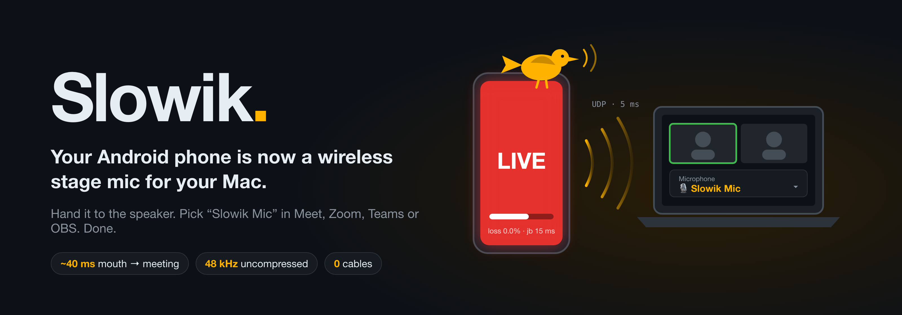
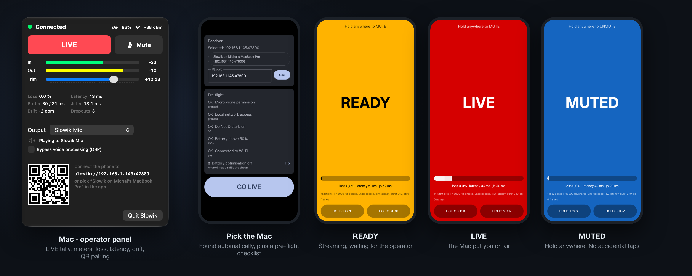
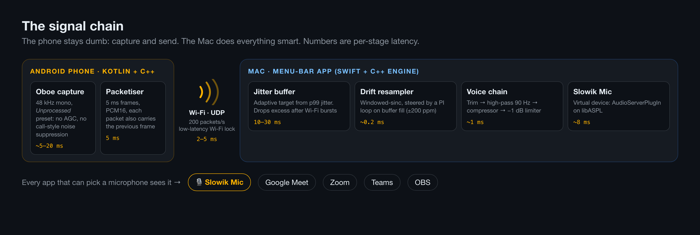
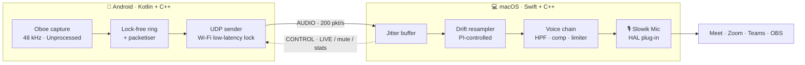
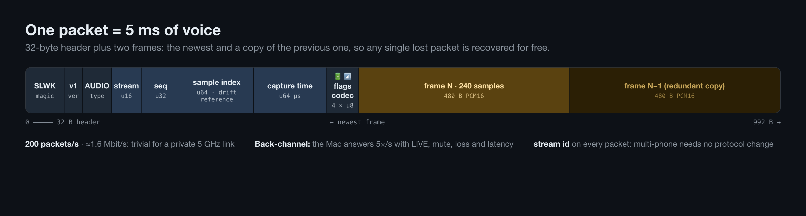
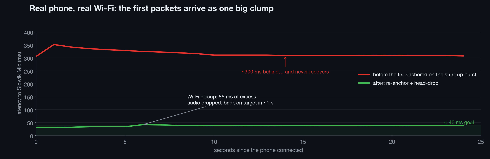
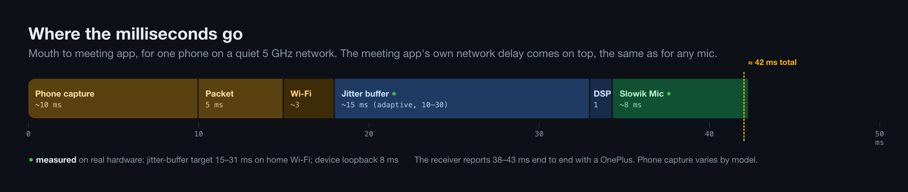

<p align="center">
  
</p>

**Your talk is being streamed on Google Meet, and the only mic in the room is a laptop three metres away.**
Everyone online hears a cathedral. Slowik fixes that with the device already in your pocket: hand an Android phone to
the speaker, and their voice arrives on your Mac **~40 ms later** as a real system microphone called **Slowik Mic**.
It works in Meet, Zoom, Teams and OBS. No cables, no dongles, no Bluetooth call-quality audio.

*Slowik* (pronounced "SWO-veek") is Polish for **nightingale**, the bird that sings live, loud and clear.

<p align="center">
  
</p>

> **Status:** working MVP. One phone → one Mac, tested on a OnePlus phone (Android API 37) and macOS 27 on Apple
> Silicon. Built in the open: see the [roadmap](#roadmap).

---

## Why not just…

| Option | Why it falls short on a stage |
|---|---|
| The laptop's built-in mic | It's 3 m away and pointed at the speaker's back. Room echo is all you get. |
| A Bluetooth headset | Phone-call quality: [8–16 kHz HFP](https://learn.microsoft.com/windows-hardware/drivers/bluetooth/bluetooth-classic-audio) and 30–100+ ms of latency. |
| A wireless lav kit | Works great, costs money, and someone has to own, charge and pack it. |
| A "phone as webcam/mic" app | Built for desk calls: phone-side noise suppression, no stage tally, no mute you can't hit by accident, no drift control for a 45-minute talk. |

Slowik is built for **the stage**: a big LIVE / MUTED tally the speaker can read from a distance, mute that needs a
deliberate long-press, a touch lock for sweaty hands, a pre-flight checklist, and a Mac side that keeps the stream
glitch-free for hours.

## How it works

<p align="center"></p>



Three pieces, one repo:

| Piece | What it is | Tech |
|---|---|---|
| [`android/`](android/) | The sender. Captures and streams, nothing else. | Kotlin, Jetpack Compose, C++ with [Oboe](https://github.com/google/oboe) |
| [`macos/Receiver/`](macos/Receiver/) | Menu-bar app: buffering, drift correction, DSP, operator controls | SwiftUI, a C++17 real-time engine, AVAudioEngine |
| [`macos/Driver/`](macos/Driver/) | The **Slowik Mic** virtual audio device | AudioServerPlugIn on [libASPL](https://github.com/gavv/libASPL) |

## The interesting parts

Live audio over Wi-Fi sounds simple until you try it for 45 minutes in front of an audience. These are the problems
Slowik solves and how.

### 1. Turn off the phone's brain

Phones assume you're on a call. They run automatic gain, noise suppression and echo cancellation, which makes a
voice pump and smear. Slowik opens the mic with Oboe's **`Unprocessed`** input preset (falling back to
`VoicePerformance`) in low-latency mode, and never uses `VoiceCommunication`. The raw signal is quiet, so all gain
and processing happen on the Mac, where there's CPU to spare and an operator to tune it.

The audio callback does exactly one thing: it copies samples into a **lock-free ring buffer**. Packetising and
networking run on a separate thread. There is no allocation, locking or syscall on the real-time path.

### 2. Lose a packet, lose nothing

<p align="center"></p>

Every packet carries 5 ms of new audio **plus a copy of the previous 5 ms**. A single lost packet is recovered
for free. When two in a row go missing, the receiver conceals the gap with a short crossfaded repeat, never a click.
The full byte layout is in [`docs/PROTOCOL.md`](docs/PROTOCOL.md).

### 3. Wi-Fi naps, and the buffer has to forgive it

Wi-Fi power-save makes radios doze between beacons. Packets then arrive in clumps instead of a steady stream. The
phone holds a `WIFI_MODE_FULL_LOW_LATENCY` lock while live, and the Mac runs an **adaptive jitter buffer**: its
target follows the 99th percentile of measured arrival jitter, ignoring one-off spikes. When a burst overfills it,
the receiver drops whole frames from the head with a 2 ms crossfade, so latency snaps back instead of drifting
forever.

<p align="center"></p>

### 4. Two clocks, two opinions about how long a second is

The phone's audio clock and the Mac's never agree exactly. A 50 ppm mismatch is 2.4 samples per second: harmless
for a minute, but **180 ms of drift per hour**, enough to empty or overflow any buffer. Slowik measures drift from
the sample index in every packet and feeds the buffer fill level into a **PI controller**. The controller steers a
windowed-sinc resampler by up to ±200 ppm, a pitch change of 0.35 cents that no one can hear.

### 5. Why there's a driver

Google Meet, Zoom and Teams only list **system audio devices**. An app can't simply "be" a microphone. Slowik ships
a tiny CoreAudio **AudioServerPlugIn** built on [libASPL](https://github.com/gavv/libASPL). The receiver plays into
the device's output, and meeting apps record from its input. Inside is a sample-time-indexed loopback ring that
returns silence, never stale audio, when nobody is writing. A tone through the installed device came back in
**~8 ms**.

### 6. Where the milliseconds go

<p align="center"></p>

## Quick start

You need an Android phone (Android 10+), a Mac (Apple Silicon, macOS 14+) and a Wi-Fi network both can reach. For
real events, use your own 5 GHz travel router instead of venue Wi-Fi.

**1. Install the Slowik Mic driver** (asks for your password, restarts CoreAudio):
```sh
cd macos/Driver && ./build.sh && ./install.sh
tools/loopback_check.sh            # optional: plays a tone through the device and measures it
```

**2. Run the receiver** (needs [XcodeGen](https://github.com/yonaskolb/XcodeGen)):
```sh
cd macos/Receiver/App && xcodegen generate
xcodebuild -project SlowikReceiverApp.xcodeproj -scheme SlowikReceiver -configuration Release \
  -derivedDataPath build/DerivedData build
open "build/DerivedData/Build/Products/Release/Slowik Receiver.app"
```
Allow **Local Network** access when macOS asks.

**3. Install the phone app** (Android SDK, phone in USB debugging mode):
```sh
cd android && ./gradlew :app:installDebug
```
Open **Slowik**. Your Mac shows up as *"Slowik on …"*. Tap it, check the pre-flight list, then hit **GO LIVE**.

**4. In Meet / Zoom / Teams**, choose **Slowik Mic** as the microphone and set the app's noise suppression to
**low or off**. Slowik already cleans up the voice, and two noise suppressors fight each other. Reload the Meet tab
after installing the driver.

## Try it without a phone

[`tools/slowik_sim.py`](tools/slowik_sim.py) is a reference implementation of the protocol that can play either
side, with a nasty network on demand:

```sh
python3 tools/slowik_sim.py send --host 127.0.0.1 --seconds 30 \
    --loss 0.02 --jitter-ms 8 --ppm 150 --burst-start-ms 300   # a fake phone on bad Wi-Fi
python3 tools/slowik_sim.py receive --wav out.wav             # a fake Mac
```

The receiver's engine has a deterministic simulator too: `cd macos/Receiver && swift test` replays ten minutes
of lossy, jittery, clock-skewed audio in under a second.

## On stage

- **Phone:** charged above 50 %, Do Not Disturb on, Wi-Fi on, screen pinned, touch lock on. Talk across the bottom
  edge from 5–10 cm away. That does more for quality than any plug-in.
- **Mac:** phone shows **LIVE**, meters moving, loss 0 %, latency under 50 ms, Slowik Mic selected in the meeting app.
- **Network:** a dedicated 5 GHz router beats venue Wi-Fi every time. Client isolation and blocked multicast are
  common on venue networks. If the Mac isn't found automatically, type the IP shown in the receiver.

## Roadmap

- [x] Android sender: Oboe, 5 ms PCM packets with redundancy, foreground service, stage UI
- [x] Mac receiver: adaptive jitter buffer, drift resampler, voice chain, menu-bar operator panel
- [x] Slowik Mic virtual device (loopback HAL plug-in)
- [ ] QR pairing plus per-packet authentication, so nobody else on the network can inject audio
- [ ] Opus low-delay fallback for congested air
- [ ] Shared-memory driver: one less buffer, and no output device in the list
- [ ] Multi-phone: one stream per speaker, a mixer, one-click swap
- [ ] RNNoise, backup recordings, signed and notarised installer, Homebrew cask
- [ ] iOS sender

The design write-up behind all of this, including prior art, transport trade-offs and the latency budget, is in
[`docs/plan.md`](docs/plan.md).

## Credits

[libASPL](https://github.com/gavv/libASPL) by Victor Gaydov makes writing a HAL plug-in sane. [Oboe](https://github.com/google/oboe)
makes low-latency Android audio possible. [Roc](https://github.com/roc-streaming) showed that this whole idea works.

## Licence

[MIT](LICENSE)
