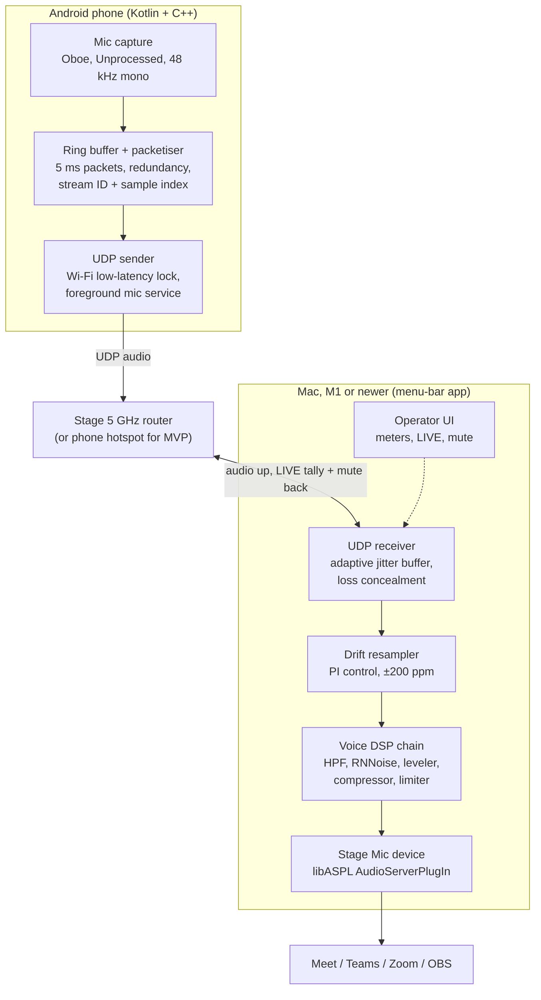

# Phone as Stage Mic for Mac — Research & Build Plan

_Research draft · 29 Oct 2026_

## TL;DR

Build a native Android sender and a Mac receiver that stream 48 kHz mono in 5 ms UDP packets over a stage Wi-Fi network you control. Expose the result as a system-wide virtual microphone that Google Meet, Teams, Zoom and OBS can all select. Expect about 40 ms end to end.

- **Scope for v1:** stream only (no room PA), one dedicated Android phone, macOS on M1 or newer. The design keeps room for multiple phones and iOS later.
- **Transport:** UDP on a dedicated 5 GHz travel router. The phone's own hotspot is fine for the single-phone MVP when the laptop has Ethernet. Never Bluetooth; venue Wi-Fi only as a last resort.
- **Phone:** Kotlin + C++ with Oboe, `Unprocessed` input preset, Wi-Fi low-latency lock, foreground microphone service. Capture and send only.
- **Codec:** raw PCM on your own network; Opus restricted-low-delay with 5 ms frames and packet redundancy as the fallback for congested air.
- **Mac:** a menu-bar app does jitter buffering, clock-drift resampling and DSP. A small libASPL AudioServerPlugIn exposes the virtual mic. This driver is required, because meeting apps only see system audio devices.
- **Processing:** trim → high-pass → optional RNNoise → expander → EQ/de-esser → leveler + compressor → true-peak limiter. Well under one M1 core, 0–10 ms added. Turn off the meeting app's own noise suppression so the two chains don't fight.
- **First spike:** install Roc Droid + Roc VAD and join a Meet or Zoom test call to measure your network before writing code.

## Decisions

| # | Question | Decision | Consequence for the design |
| --- | --- | --- | --- |
| 1 | Stream only, or also the room PA? | **Stream only** | Latency target ≤ 40 ms (tolerable ≤ 80 ms). No feedback risk. The PA path is out of scope. |
| 2 | Which apps consume the mic? | **Google Meet, Teams, Zoom and similar** (plus OBS) | A system-wide virtual audio device is mandatory, so the OBS-plugin shortcut is dropped. These apps run their own processing, which must be turned down. |
| 3 | Speakers' phones or dedicated phones? | **Dedicated phone to start** | One known, tested Android model. No guest installs or permissions. iOS is deferred. The phone can be locked down (screen pinning, no notifications). |
| 4 | How many phones at once? | **One at first, multiple later** | The MVP handles one stream. The packet format and the Mac pipeline carry a stream ID from day one, so multi-phone needs no protocol change. |

## Requirements and constraints

The hard requirement is a stage-proof link: no dropouts for a 45-minute talk, and under 40 ms from mouth to the meeting app, in a room full of congested Wi-Fi.

| Requirement | Target | Why |
| --- | --- | --- |
| End-to-end latency | ≤ 40 ms, tolerable ≤ 80 ms | Meeting apps have no A/V sync offset. At about 40 ms of late audio, lip-sync is generally not noticeable. |
| Audio format | 48 kHz, mono, float or 24-bit, phone voice processing off | Call-tuned AGC, noise suppression and echo cancel make a voice pump and smear |
| Reliability | 0 audible dropouts in 45 min; reconnect < 1 s | A silent mic on stream is the one failure everyone notices |
| Network | Must not depend on venue Wi-Fi | Venue Wi-Fi often has client isolation, captive portals, blocked mDNS/UDP and hundreds of clients |
| Handling | Hand-held, moving, pocketed between talks | Handling noise, plosives, varying distance, screen lock, notifications, battery |
| Operator | One person at the laptop | Needs meters, mute, "who is live" and, later, fast phone swaps between speakers |
| Compatibility | Any macOS app that picks a microphone | Meet in the browser, Teams, Zoom and OBS must all list the device |

## Prior art

Several apps already turn a phone into a Mac mic. All of them are built for desk calls rather than a stage: none offers stage monitoring, failover, handling-noise control or a mic-swap workflow.

| Product | Platforms | Transport | How it appears on Mac | Gap for a stage |
| --- | --- | --- | --- | --- |
| [WO Mic](https://maketecheasier.com/use-android-as-microphone-computer/) | Android, iOS → Win/Mac/Linux | Wi-Fi, USB, Bluetooth, Wi-Fi Direct | Mac client, no driver needed | Built for desk calls, no processing or monitoring |
| [AudioRelay](https://docs.audiorelay.net/instructions/macos) | Android → Win/Mac/Linux | Wi-Fi, USB | Needs a third-party virtual device (BlackHole, VB-Cable) | Extra install; routing is manual |
| [PhoneMic](https://alternativeto.net/software/phonemic/about/) | Android, iPhone → Win/Mac | UDP over local Wi-Fi, 48 kHz mono, 10 ms packets | Free receiver shows up as a standard mic | Closest in design; subscription, no stage features |
| MicYou | Android → PC | Wi-Fi, USB | Virtual mic | Windows-first |
| [Apple Continuity Camera mic](https://support.apple.com/guide/mac-help/mchl77879b8a/) | iPhone → Mac (macOS 13+) | Wireless or USB | Native input device in Sound settings | iPhone only, same Apple Account, one phone per Mac, latency and processing not documented |

Two takeaways shape the design. PhoneMic shows the right wire format: 48 kHz mono in 10 ms UDP packets. AudioRelay shows the UX cost of not shipping your own virtual device, since users must install and route BlackHole themselves.

When iOS comes back on the table, Continuity Camera is a free baseline to test first. It requires both devices on [the same Apple Account with two-factor authentication](https://support.apple.com/en-ge/102546). That is fine for a dedicated, org-owned iPhone.

## Transport options

Use UDP over a dedicated 5 GHz Wi-Fi network you control. Keep Bluetooth out entirely, and treat USB as a fallback for a fixed position, not the main path.

| Transport | Latency | Quality ceiling | Stage fit | Notes |
| --- | --- | --- | --- | --- |
| **UDP over own 5 GHz router** (recommended) | 2–5 ms typical, spikes on busy air | Full-band 48 kHz, PCM or Opus | Wireless, multi-phone | Small travel router at the stage: one SSID, WPA2, 5 GHz only, fixed channel. Most travel routers can also use venue Wi-Fi as their uplink, which keeps the laptop online for Meet, Teams and Zoom. |
| UDP over the phone's own hotspot | Similar, one hop fewer | Same | Wireless, one phone only | Fine for the single-phone MVP, but only when the laptop has Ethernet for internet. Put Ethernet first in the macOS service order. |
| UDP over venue Wi-Fi | Unpredictable | Same | Risky | Client isolation, blocked mDNS and congestion are common; last resort only |
| WebRTC from a browser page | Usually 50–150 ms with the default jitter buffer | Opus full-band | Zero-install guest path | Needs HTTPS on a local host and stops on screen lock; not needed with dedicated phones |
| USB, Android | Lowest, no RF | PCM | Lectern or fixed mic only | macOS has [no RNDIS driver](https://nothing.community/d/57757-migrate-usb-tethering-from-rndis-to-cdc-ncm-for-native-macos-windows-support); CDC-NCM tethering [works only on some Android 13+ phones](https://zenn.dev/cyberrex/articles/55cd91137c3a5f); Android Open Accessory via libusb works on any phone but takes more effort |
| USB, iPhone | Lowest | PCM | Lectern | Tunnel over usbmux, or use Continuity Camera's wired mode |
| Bluetooth (HFP) | 30–100+ ms | [8 kHz CVSD or 16 kHz mSBC, mono](https://learn.microsoft.com/windows-hardware/drivers/bluetooth/bluetooth-classic-audio) | Poor | Phone-call quality. LE Audio with LC3 is better but can't be used as a Mac input today. |

Two phone-side settings matter more than the radio choice:

- Hold a `WIFI_MODE_FULL_LOW_LATENCY` Wi-Fi lock on Android 10+. It [disables Wi-Fi power save](https://source.android.google.cn/docs/core/connect/wifi-low-latency?hl=ko) while the app is in the foreground with the screen on. Power-save wake-ups are the classic cause of 100 ms jitter spikes.
- Keep the app in the foreground with the screen on, dimmed and touch-locked. Background capture on both platforms is throttled and can be killed.

Discovery: advertise the Mac receiver over Bonjour (NSD on Android). Always show a QR code with IP and port as a fallback, because many venue networks block mDNS.

## Codec and latency budget

Send 48 kHz mono in 5 ms packets: raw PCM on your own router, with Opus restricted-low-delay as the switchable fallback for congested air. End-to-end latency is typically 25–45 ms (worst case about 75 ms), and the jitter buffer is the biggest share.

**Codec choice**

- **PCM, 24-bit, 48 kHz mono** is about 1.15 Mbit/s plus headers, at 200 packets/s. That is trivial for a private 5 GHz link, with zero codec delay and no artifacts.
- **Opus, restricted low delay** forces CELT only. With 2.5 ms frames its [algorithmic delay is about 5 ms](https://libopus.web.app/article/minimum-algorithmic-latency-of-libopus); 5 ms frames add 2.5 ms more. At 128–160 kbit/s mono it is transparent for speech and cuts airtime about 8×, which helps on busy channels.
- Opus in-band FEC only works in SILK and hybrid modes, which [need 10 ms frames or longer](https://en.wikipedia.org/wiki/Opus_(audio_format)). In CELT mode, protect against loss with packet redundancy instead: each packet also carries the previous 1–2 frames. At 5 ms frames that costs a few kbit/s and hides most single and double losses; Opus PLC covers the rest.

**Latency budget (design estimates, to be measured per device)**

| Stage | Budget | Lever |
| --- | --- | --- |
| Phone capture buffer (AAudio low-latency input) | 5–20 ms | Device-dependent; measure on the chosen phone |
| Packetisation | 5 ms | Frame size |
| Codec (Opus CELT 5 ms) | 2.5 ms (0 for PCM) | Codec choice |
| Wi-Fi air time and queueing | 2–5 ms | Own router, 5 GHz, Wi-Fi low-latency lock |
| Receiver jitter buffer | 10–30 ms | Adaptive target, the main knob |
| Mac processing (RNNoise frame) | 0–10 ms | Turn denoise off when the room is quiet |
| Virtual device IO buffer | 1–5 ms | 64–128 frame buffer |
| **Total** | **≈ 25–75 ms, target ≤ 40 ms** | |

Meeting apps add their own encode and network delay on top, but that is the same for any microphone. In OBS, set the measured latency as the audio sync offset once, at sound check.

## Phone app

Build native apps around one shared C++ core that handles the packet format, Opus, redundancy and clock stamps. The phone does capture and transport only; all processing happens on the Mac.

**Android (v1): Kotlin UI + C++ core with Oboe**

- Open an Oboe input stream: `PerformanceMode::LowLatency`, `SharingMode::Exclusive`, 48 kHz, mono, float.
- Use the `Unprocessed` input preset first. It gives [no effects and no AGC, so the level may be very low](https://docs.rs/oboe-sys/0.3.0/oboe_sys); apply gain on the Mac, not the phone. Fall back to `VoicePerformance`, which is [meant for live performance and minimises latency](https://docs.rs/oboe/latest/oboe/enum.InputPreset.html). Presets only take effect on Android 9 (API 28) and later.
- Never use `VoiceCommunication`, which switches on call-style echo cancel, noise suppression and AGC.
- The audio callback only writes into a lock-free ring buffer. A separate thread packetises and sends over UDP. No allocation, locks or network calls happen in the callback.
- Run capture in a foreground service with `foregroundServiceType="microphone"`. On Android 14+ it [must be started while the app is visible](https://github.com/PiotrPrus/AudioCapture/wiki), so start it from the "Go live" tap.
- Hold the `WIFI_MODE_FULL_LOW_LATENCY` lock, keep the screen on but dimmed, and show a touch lock so a gripping hand can't hit buttons.
- Each packet carries the stream ID, sequence number, capture sample index, phone monotonic time, battery level and RSSI. The Mac needs the sample index to measure clock drift. The stream ID is always 0 in v1 but makes multi-phone a receiver-only change later.

**Dedicated-phone setup**

- Pick one Android model and verify that it reports `Unprocessed` support and low input latency. Keep that model on a tested-device list.
- Use screen pinning (or lock-task mode if the phone is device-owner managed), so the app can't be swiped away on stage.
- Exempt the app from battery optimisation, turn off auto-updates for the OS and apps before event days, and leave Do Not Disturb permanently on.

**Phone UI, built for the stage**

- One big state: READY / LIVE / MUTED. The Mac drives the LIVE tally, because the operator decides when a phone is on air.
- A mute toggle that is hard to hit by accident (long press), plus a level meter so the speaker sees they are being heard.
- A pre-flight screen that checks Do Not Disturb, battery above 50% and the stage network, then runs a 5-second "say something" test.

**iOS (deferred): Swift + the same C++ core**

- Use `AVAudioSession` category `.record` (or `.playAndRecord`) with mode `.measurement`, which [minimises system signal processing and uses the primary microphone](https://developer.apple.com/documentation/avfaudio/avaudiosession/mode-swift.struct/measurement.md). It also lowers the input level, so again, gain goes on the Mac.
- Ask for a 5 ms IO buffer with `setPreferredIOBufferDuration(0.005)` and 48 kHz before activating the session, then read back what you actually got.
- Capture through a RemoteIO audio unit or an `AVAudioEngine` input tap. Enable the background audio mode and disable the idle timer.
- Add `NSLocalNetworkUsageDescription` and the Bonjour service type to Info.plist. Without them, the local-network prompt silently blocks discovery.
- Test Continuity Camera's mic first. With a dedicated iPhone on the same Apple Account, it may be good enough on its own.

## Mac receiver and virtual microphone

Ship a menu-bar receiver app plus your own thin AudioServerPlugIn driver that exposes a "Stage Mic" input. All networking and DSP stay in the app; the driver only copies samples. Because Meet, Teams and Zoom only see system audio devices, the driver is required from the MVP onward.

**Why an AudioServerPlugIn**

- It is the only route for a virtual device. AudioDriverKit is for hardware, and Apple [won't grant its entitlement for virtual drivers](https://developer.apple.com/forums/thread/736357).
- AudioServerPlugIns can't ship through the Mac App Store. Distribute a Developer ID–signed, notarized `.pkg` that installs into `/Library/Audio/Plug-Ins/HAL` and restarts `coreaudiod`. For an open-source project, also publish build-from-source steps and a Homebrew cask.
- Write it with [libASPL](https://github.com/gavv/libASPL) (C++17, MIT). It is a thin shim over the HAL plugin API and handles the boilerplate. BlackHole is a good reference but GPL-3.0, so check licence compatibility before borrowing code.

**Ways to wire it**

| Option | How | Pros | Cons | Status |
| --- | --- | --- | --- | --- |
| A. OBS plugin, no driver | An OBS audio source plugin receives UDP directly | No driver install | Only works in OBS | **Dropped**: Meet, Teams and Zoom need a system device |
| B. App + loopback device | The app plays processed audio into its own 2-channel loopback; other apps record from its input side | Simple driver, works in every app | One extra IO buffer (~2–5 ms) | **MVP** |
| C. App + shared-memory device | The driver reads a lock-free ring that the app fills, via shared memory | Lowest latency, cleanest UX, one "Stage Mic" device | Most driver work; IPC into the `coreaudiod` sandbox | **Target** |

**Receiver app (Swift UI, C++ engine)**

- `Network.framework` `NWListener` on UDP, Bonjour advertising, and a QR code for manual pairing.
- Per-stream pipeline: jitter buffer → drift-compensating resampler → DSP chain → device ring. v1 runs one instance; multi-phone runs one per stream ID, followed by a mixer or a selector.
- Operator UI: meters, LIVE/mute, packet-loss and latency readouts. "Swap to phone 2" arrives with multi-phone.
- Expose the device as 48 kHz mono, plus a dual-mono stereo variant for apps that ignore mono inputs.

**Meeting-app settings**

Meet, Teams and Zoom run their own noise suppression, auto-gain and echo cancellation, which fight the Mac chain and can chop or pump a clean voice. Where an app exposes it, turn noise suppression to its lowest setting and enable its "original sound" or music mode. Restart the app (or reload the browser tab for Meet) after installing the driver, so the new device appears in its microphone list.

**Shortcut worth a day: Roc**

[Roc VAD](https://github.com/roc-streaming/roc-vad) is an MPL-2.0 macOS virtual device built on libASPL, and [Roc Droid](https://github.com/roc-streaming/roc-droid) is its Android sender. Roc already does fixed-latency streaming, FEC and clock-domain conversion over RTP. Install both, and you have a working phone mic in a Meet or Zoom test call in an evening. That is the fastest way to measure real network behaviour.

There are two reasons not to build the product on Roc as-is. First, its defaults target [200 ms latency with 5 ms packets and FEC blocks of 18 source + 10 repair packets](https://github.com/roc-streaming/roc-vad); the FEC block alone spans 90 ms, so 40 ms needs much smaller blocks. Second, Roc built with OpenFEC [must be distributed under a CeCILL-compatible, GPL-like licence](https://gavv.github.io/articles/roc-0.1). Roc Droid is also still marked as work in progress.

## Audio processing on the Mac

A classic broadcast voice chain of seven cheap stages fixes what a hand-held phone gets wrong: rumble, distance swings and peaks. It uses well under one M1 core and adds 0–10 ms of latency, the 10 ms only when denoise is on.

| # | Stage | Starting settings | Fixes | Added latency |
| --- | --- | --- | --- | --- |
| 1 | Input trim | +10 to +20 dB, set at sound check | Low level from unprocessed capture | 0 |
| 2 | High-pass filter | 80–100 Hz, 18–24 dB/oct | Handling thumps, plosive rumble, HVAC | 0 |
| 3 | Noise suppression (optional) | RNNoise, 60–80% wet | Fans, crowd hum between phrases | 10 ms |
| 4 | Downward expander | Threshold about −50 dBFS, 1:2, slow release | Room noise in pauses, gently | 0 |
| 5 | EQ + de-esser | Cut 250–400 Hz if boomy; dynamic cut at 5–8 kHz | Thin, harsh MEMS-mic tone and sibilance | 0 |
| 6 | Leveler, then compressor | Leveler with 1–3 s time constants; compressor 3:1, 5–10 ms attack, 100–200 ms release, 4–6 dB gain reduction | Speaker moving the phone closer and further | 0 |
| 7 | True-peak limiter | 1–2 ms look-ahead, ceiling −1 dBTP | Shouts, laughs, drops | 1–2 ms |

These are starting points to tune by ear at sound check, not measured values. Meeting apps level the signal again, so aim for a steady level with peaks around −6 dBFS. For OBS streams, target about −16 LUFS integrated. The operator UI should show short-term LUFS, true peak and gain reduction.

**How to build it cheaply**

- MVP: chain Apple's built-in Audio Units in `AVAudioEngine` (high-pass filter, dynamics processor, peak limiter). This needs no DSP code and runs on Accelerate.
- Production: move the chain into the C++ engine (vDSP biquads, a simple RMS compressor, a look-ahead limiter). It then runs in the same thread as the jitter buffer, processing 5 ms blocks.
- RNNoise works on [10 ms frames at 48 kHz and costs about 1% of one x86 core](https://w3.org/2020/06/machine-learning-workshop/talks/rnnoise_neural_speech_enhancement_and_the_browser.html), so it is effectively free on an M1. Keep it switchable and blend wet with dry, because full-wet RNNoise can sound watery on clean speech. Heavier models such as DeepFilterNet sound better but belong in post-production, not a live chain.
- Put the denoiser after the high-pass filter. It can't fix handling thumps and would waste effort on them.

What processing can't fix is a phone's MEMS mic held at chest height. Teach speakers to talk across the bottom edge from 5–10 cm away; that does more than any plug-in.

## Reliability and stage operations

The two failures that sink live audio are slow clock drift and silent dropouts. Design both out, then run a checklist before every talk.

**Engineering must-haves**

- **Clock drift.** The phone's audio clock and the Mac's never match exactly. A 50 ppm mismatch is 2.4 samples per second, or 180 ms per hour, which empties or overflows any jitter buffer within minutes. Drive an asynchronous resampler (Speex or libsamplerate quality) from the jitter-buffer fill level with a slow PI controller, and limit the ratio to ±200 ppm.
- **Adaptive jitter buffer.** Target the 99th percentile of measured arrival jitter plus a small margin. Grow fast, and shrink only during speech pauses so changes are inaudible.
- **Loss concealment.** Use redundant frames first, then Opus PLC (or a 5 ms crossfade-repeat for PCM). Never output a hard zero, because it clicks.
- **Link loss.** After 150 ms without packets, fade to silence, flash red on both screens and auto-reconnect. Optionally, crossfade to a backup source (lav or laptop mic) when the link goes quiet, as opposed to the speaker pausing.
- **Backups.** The phone writes a local WAV while streaming, and the Mac records raw and processed tracks. Either one can rescue the recording.
- **Security.** Pair by a QR code that carries a session key, and authenticate every packet (for example with ChaCha20-Poly1305). Otherwise anyone on the same network can inject audio into your call.
- **Soak testing.** Before each release, do a 2-hour run on a busy 5 GHz network, logging loss, jitter, buffer target and drift ratio.

**Pre-talk checklist (phone)**

- [ ] Dedicated phone, app updated, charged above 50% (power bank in the green room)
- [ ] Airplane mode on, Wi-Fi on, joined to the stage network only
- [ ] Do Not Disturb on, so no calls, alarms or notification sounds
- [ ] App pinned; case removed if it rattles; screen locked to touch
- [ ] Speaker briefed: bottom edge toward the mouth, 5–10 cm away, don't cover the mic hole, don't swap hands mid-sentence

**Pre-talk checklist (laptop)**

- [ ] Laptop online through venue Ethernet or the travel router's uplink
- [ ] Phone shows LIVE, meters moving, loss 0%, latency readout under 50 ms
- [ ] Stage Mic selected as the microphone in Meet, Teams or Zoom, with the app's noise suppression at its lowest
- [ ] For OBS: audio sync offset set from the measured latency
- [ ] Backup mic patched and labelled

## Architecture and build plan

Keep the phone dumb and the Mac smart: the phone captures and sends, one Mac app does everything else, and a small driver is the only system-level piece.

Audio flows top to bottom. The link through the router is two-way, so the Mac can drive the phone's LIVE tally and mute. The Stage Mic device is what every app sees.

**Phased plan (rough estimates for one engineer)**

1. **Spike, 2–3 days.** Run Roc Droid + Roc VAD into a Meet or Zoom test call on the chosen dedicated phone. Measure latency by recording a clap on the laptop mic and Stage Mic together, then do a 1-hour soak on a travel router. Gate: no dropouts in an hour at ≤ 60 ms.
2. **MVP, 3–4 weeks.** Single phone. Build the Android sender (Oboe, PCM, 5 ms, redundancy, stream ID in every packet) and the Mac app (jitter buffer, drift resampler, Apple Audio Unit chain). Ship a loopback-style Stage Mic driver (option B) in a notarized installer. Gate: a 45-minute soak with zero audible dropouts at ≤ 50 ms, verified in Meet, Teams and Zoom.
3. **Stage-ready, 3–4 weeks.** Shared-memory driver (option C), operator UI, QR pairing with packet authentication, failover to a backup mic, Opus fallback. Gate: a dry run at a meetup with a real speaker.
4. **Multi-phone, 2–3 weeks.** Run one pipeline per stream ID, add a mixer or selector, per-phone LIVE/mute, and one-click swap. Move to router-only networking.
5. **Later.** iOS app on the shared C++ core (if Continuity Camera falls short), USB via Android Open Accessory, a browser guest join, a room PA output.

## Risks

The biggest risk is physics, not software. A phone's MEMS mic held in a hand will not beat a decent handheld dynamic mic, so "amazing" means clean and consistent, not studio-grade.

| Risk | Likelihood | Mitigation |
| --- | --- | --- |
| The chosen phone lacks `Unprocessed` support or has high input latency | Medium | Test 2–3 candidate models in the spike; keep a tested-device list |
| Meeting apps' own processing fights the Mac chain | High | Lowest noise-suppression setting, original-sound/music mode, document per app |
| Venue RF congestion causes dropouts | Medium | Own 5 GHz router at the stage, redundancy, adaptive buffer, wired lav as backup |
| Handling noise and distance swings | High | High-pass filter, leveler, speaker briefing, optional foam sleeve over the mic port |
| A macOS update breaks the HAL plugin | Low–medium | Keep the driver tiny; test each macOS beta |
| Audio injection from someone on the network | Low, high impact | QR pairing plus per-packet authentication |
| Battery or thermal shutdown in a long session | Low | Charge between talks, dim the screen, PCM instead of Opus on the phone |

**Still open**

- Which Android model will be the dedicated phone?
- Will the laptop have venue Ethernet, or should the travel router provide its uplink?
- Licence for the open-source project (MIT/Apache-2.0 vs MPL-2.0 if any Roc code is reused), and the project name.

## Sources

- [AudioRelay macOS docs](https://docs.audiorelay.net/instructions/macos)
- [PhoneMic on AlternativeTo](https://alternativeto.net/software/phonemic/about/)
- [WO Mic setup guide (Make Tech Easier)](https://maketecheasier.com/use-android-as-microphone-computer/)
- [Apple: use iPhone as a webcam or mic on Mac](https://support.apple.com/guide/mac-help/mchl77879b8a/)
- [Apple: Continuity Camera requirements](https://support.apple.com/en-ge/102546)
- [Apple: AVAudioSession.Mode.measurement](https://developer.apple.com/documentation/avfaudio/avaudiosession/mode-swift.struct/measurement.md)
- [Apple Developer Forums: virtual audio drivers need AudioServerPlugIn](https://developer.apple.com/forums/thread/736357)
- [libASPL](https://github.com/gavv/libASPL)
- [Roc VAD](https://github.com/roc-streaming/roc-vad) and [Roc Droid](https://github.com/roc-streaming/roc-droid)
- [Roc 0.1 release notes and licensing](https://gavv.github.io/articles/roc-0.1)
- [Oboe InputPreset reference](https://docs.rs/oboe/latest/oboe/enum.InputPreset.html) and [Oboe constants](https://docs.rs/oboe-sys/0.3.0/oboe_sys)
- [Android Wi-Fi low-latency mode](https://source.android.google.cn/docs/core/connect/wifi-low-latency?hl=ko)
- [Android foreground service types](https://developer.android.com/develop/background-work/services/fg-service-types)
- [Android MicrophoneDirection](https://developer.android.com/reference/android/media/MicrophoneDirection)
- [Opus minimum algorithmic latency](https://libopus.web.app/article/minimum-algorithmic-latency-of-libopus) and [Opus frame sizes (Wikipedia)](https://en.wikipedia.org/wiki/Opus_(audio_format))
- [RNNoise complexity (W3C talk)](https://w3.org/2020/06/machine-learning-workshop/talks/rnnoise_neural_speech_enhancement_and_the_browser.html)
- [Bluetooth classic audio profiles (Microsoft)](https://learn.microsoft.com/windows-hardware/drivers/bluetooth/bluetooth-classic-audio)
- [Android USB tethering on macOS via CDC-NCM (Zenn)](https://zenn.dev/cyberrex/articles/55cd91137c3a5f)
